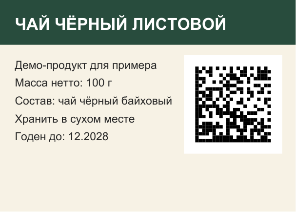

# Этикетки с кодами «Честный знак»

Программа берёт шаблон этикетки (PDF) и файл кодов маркировки, выгруженный из «Честного знака» (PDF), и собирает готовый к печати тираж: на каждой этикетке свой код, ни один код не уходит дважды.



## Задача

Производителю нужно печатать этикетки с уникальными кодами Data Matrix. Коды приходят отдельным PDF, по коду на страницу. Вручную переносить их в макет долго, а ошибка обходится дорого: если код повторится или окажется испорчен, партия не пройдёт приёмку.

## Как устроено

**Код не распознаётся и не рисуется заново.** Data Matrix переносится из исходного PDF как векторный объект. Под кодом печатаются только GTIN и серийный номер, а «криптохвост» (часть после разделителя GS и `93`) существует только внутри самого кода. Если код распознать и сгенерировать заново, хвост легко потерять. При переносе его содержимое физически не меняется.

**Свободное поле вокруг кода.** Сканер не читает Data Matrix, обрезанный вплотную по модулям. Поле в 2 модуля добавляется автоматически, а размер модуля определяется по самому коду.

**Учёт использованных кодов в SQLite.** Партия проходит этапы `RESERVED → SUCCESS`, коды переходят в статус `USED`. Если сборка упала, коды освобождаются, а партия помечается `FAILED`, поэтому повторный запуск ничего не теряет и не дублирует. Коды узнаются по содержимому, а не по имени файла, так что повторная загрузка того же PDF не даст напечатать их снова.

**Лёгкий файл тиража.** Шаблон хранится в PDF один раз и подставляется ссылкой, а не копируется на каждую страницу. 400 этикеток весят 0,7 МБ и собираются за 2 секунды.

**Автопроверка результата.** Каждый код на готовых этикетках считывается декодером и сверяется с исходником: количество, уникальность, читаемость.

## Результат демо-прогона

```
Сборка тиража — 20 шт.
  размер: 141 КБ
Проверка тиража сканером: криптохвост сохранился
  страниц 20, кодов 20, уникальных 20, дублей 0, нечитаемых 0
  содержимое совпало с исходным байт в байт: ДА
Защита от повторного использования
  попытка взять 500 шт. → Недостаточно кодов. Доступно: 480, требуется: 500.
Масштаб: партия 400 шт.
  400 этикеток за 2.2 с, файл 0.7 МБ
  совпадение с исходными кодами: ДА
```

## Запуск

```bash
pip install -r requirements.txt
python run_demo.py          # полный прогон на демо-файлах
python -m pytest -q         # тесты
```

Работа с собственными файлами из командной строки:

```bash
python chestny_znak.py add-template "Чай 100 г" label.pdf --x 126 --y 40 --size 60
python chestny_znak.py inspect codes.pdf
python chestny_znak.py preview "Чай 100 г" codes.pdf
python chestny_znak.py build "Чай 100 г" codes.pdf 200 --out-dir out
python chestny_znak.py verify out/<файл тиража>.pdf
```

## Файлы

| Файл | Назначение |
|---|---|
| `chestny_znak.py` | ядро: шаблоны, разбор кодов, база, сборка и проверка тиража |
| `make_samples.py` | генератор демо-шаблона и файла с 500 кодами |
| `run_demo.py` | сквозной сценарий с выводом каждого шага |
| `tests/` | тесты: сохранность кода, отсутствие дублей, освобождение кодов при сбое |

Все коды в `samples/` выдуманные. Они устроены как настоящие (GTIN, серийный номер, криптохвост), но к реальным товарам отношения не имеют.

Стек: Python 3.12+, PyMuPDF, pylibdmtx, SQLite.
